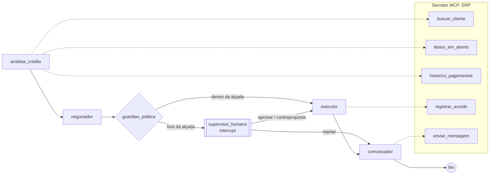

# Agentes de Renegociação de Dívidas (LangGraph + MCP)

Um time de agentes de IA que automatiza **a renegociação de títulos em atraso** de uma distribuidora
de alimentos B2B, de ponta a ponta. Os agentes analisam o crédito do cliente, montam a proposta,
checam a alçada, pedem **aprovação humana** quando passa do limite, registram o acordo, geram os
boletos no ERP e avisam o cliente.

Os agentes só acessam o sistema da empresa por um **servidor MCP**, que expõe o ERP (clientes,
títulos, acordos, boletos, caixa de mensagens) como ferramentas. Para trocar por um ERP real,
basta reimplementar o servidor MCP. O grafo não muda.

## O processo de negócio

Antes, um analista de cobrança fazia isto à mão para cada cliente inadimplente:

1. puxar os títulos em aberto e o histórico de pagamento;
2. avaliar o risco;
3. montar uma proposta (desconto + parcelas);
4. pedir aprovação ao gestor se estivesse fora da alçada;
5. lançar o acordo, emitir os boletos e baixar os títulos;
6. escrever para o cliente.

O time de agentes faz os seis passos. A pessoa só entra no passo 4, e só quando a política exige.

## Arquitetura



| Agente | Papel | Ferramentas MCP |
|---|---|---|
| `analista_credito` | Consolida dívida, histórico e tempo de casa e calcula um score de 0 a 100 | `buscar_cliente`, `titulos_em_aberto`, `historico_pagamentos` |
| `negociador` | Propõe desconto e parcelas (Claude com saída estruturada, ou regras offline) | — |
| `guardiao_politica` | Aplica a alçada da empresa: desconto até 10% e até 6 parcelas passam sem aprovação | — |
| `supervisor_humano` | Pausa o grafo (`interrupt`) e espera a pessoa aprovar, rejeitar ou contrapropor | — |
| `executor` | Grava o acordo, gera os boletos e baixa os títulos | `registrar_acordo` |
| `comunicador` | Escreve e envia a mensagem ao cliente | `enviar_mensagem` |

### Decisões de projeto

- **Supervisão humana de verdade.** O grafo usa `interrupt` + checkpointer do LangGraph, então a
  execução fica parada e retoma do mesmo ponto com `Command(resume=...)`. Nada é gravado no ERP
  antes da aprovação.
- **Limite que o LLM não fura.** A proposta é um modelo Pydantic com teto absoluto (30% e 12x).
  Nem o LLM nem uma contraproposta humana passam disso, e a alçada é checada por código, não pelo prompt.
- **Roda sem chave de API.** Com `ANTHROPIC_API_KEY`, o negociador e o comunicador usam Claude.
  Sem a chave, usam regras determinísticas. Assim os testes rodam offline e em CI.
- **Rastreabilidade.** Cada agente escreve no `log` do estado, e o acordo grava quem aprovou.

## Como rodar

```bash
pip install -r requirements.txt

# opcional: usar Claude no negociador/comunicador
export ANTHROPIC_API_KEY=...

python main.py --cliente 1                  # bom pagador: acordo automático
python main.py --cliente 2                  # alto risco: pede sua aprovação no terminal
python main.py --cliente 2 --auto rejeitar  # decisão humana simulada
python -m pytest -q                         # testes ponta a ponta (sobe o servidor MCP)
```

O banco de demonstração (`data/erp.db`) é criado automaticamente com 3 clientes de perfis diferentes.
Apague a pasta `data/` para recomeçar.

### Exemplo (cliente 2, aprovado pelo supervisor)

```
[analista_credito] Padaria Trigo de Ouro: 3 títulos em aberto, R$ 19.500,00, cliente há 3.3 anos, score 14/100.
[negociador/regras] 15.0% em 10x — Risco alto e dívida antiga: melhor recuperar parte do valor do que perder tudo.
[guardiao_politica] precisa de aprovação: desconto 15.0% acima de 10.0%; 10 parcelas acima de 6
[supervisor_humano] demo aprovou
[executor] acordo #1 gravado, 10 boletos gerados
[comunicador] mensagem enviada ao cliente
```

## Estrutura

```
erp_mcp_server.py   servidor MCP (FastMCP, stdio) sobre o ERP em SQLite
agentes.py          estado, política e grafo LangGraph com os 6 agentes
main.py             cliente MCP + execução com human-in-the-loop
tests/              testes de política, score e fluxo completo
```

## Próximos passos

- Trocar o SQLite por um conector do ERP real (só muda o servidor MCP).
- Aprovação pelo Slack/e-mail em vez do terminal, com checkpointer persistente (Postgres).
- Rodar em lote para toda a carteira vencida, com relatório diário de recuperação.
